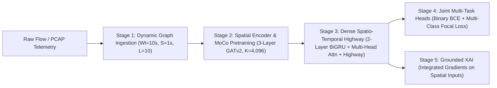

# MC-STGAT-IDS: Architecture & Pipeline Technical Specification

This document provides a comprehensive mathematical and architectural breakdown of **MC-STGAT-IDS** across all five operational stages.

---

## High-Level System Architecture



---

## Stage 1: Network Telemetry to Dynamic Graph Ingestion

### 1.1 Temporal Windowing & Sequence Construction
* **Window Duration ($W_t$):** $10\text{ seconds}$ continuous flow aggregation.
* **Stride ($S$):** $1\text{ second}$ sliding displacement.
* **Sequence Length ($L$):** $T = 10$ continuous historical graph snapshots form each input sequence:
  $$\mathcal{S} = (\mathcal{G}_1, \mathcal{G}_2, \dots, \mathcal{G}_{10})$$
* **Graph Definition:** At each time step $t$, the network graph $\mathcal{G}_t = (\mathcal{V}_t, \mathcal{E}_t)$ represents active communicating endpoints:
  - Nodes $v_i \in \mathcal{V}_t$: Unique IP hosts active during window $t$.
  - Edges $e_{ij} \in \mathcal{E}_t$: Directed communication sessions between host $v_i$ and host $v_j$.

### 1.2 Feature Representation
* **Node Feature Matrix ($\mathbf{X}_t \in \mathbb{R}^{|\mathcal{V}_t| \times 7}$):**
  1. `in_degree`: Inbound directed edge count.
  2. `out_degree`: Outbound directed edge count.
  3. `in_mean_pkt_size`: Average packet size of inbound traffic.
  4. `out_mean_pkt_size`: Average packet size of outbound traffic (primary kill-chain signature).
  5. `in_syn_ratio`: Ratio of inbound packets with SYN flag set.
  6. `out_syn_ratio`: Ratio of outbound packets with SYN flag set (scanning driver).
  7. `out_ack_ratio`: Ratio of outbound packets with ACK flag set (session termination driver).
* **Edge Feature Matrix ($\mathbf{E}_t \in \mathbb{R}^{|\mathcal{E}_t| \times 10}$):**
  1. `duration`: Flow duration in seconds.
  2. `proto`: Transport protocol (TCP, UDP, ICMP).
  3. `src_port`: Source port number (normalized).
  4. `dst_port`: Destination service port (normalized).
  5. `in_pkts`: Total inbound packet count.
  6. `out_pkts`: Total outbound packet count.
  7. `in_bytes`: Total inbound byte volume.
  8. `out_bytes`: Total outbound byte volume.
  9. `tcp_flags`: Bitmask of combined TCP control flags.
  10. `flow_rate`: Byte throughput per unit time ($B/s$).
* **Structural Graph Metrics (28-dimensional vector per snapshot):**
  - Graph-level density, diameter approximation, clustering coefficients, reciprocity, degree centrality percentiles, and spectral radius.

---

## Stage 2: Spatial Graph Encoder & Contrastive Pretraining

### 2.1 Multi-Hop GATv2 Backbone
Each snapshot $\mathcal{G}_t$ is encoded via a 3-layer Graph Attention Network (GATv2) with multi-head edge concatenation:
$$\alpha_{ij}^{(l)} = \frac{\exp\left(\mathbf{a}^\top \text{LeakyReLU}\left(\mathbf{W}_v \mathbf{h}_i^{(l-1)} + \mathbf{W}_u \mathbf{h}_j^{(l-1)} + \mathbf{W}_e \mathbf{e}_{ij}\right)\right)}{\sum_{k \in \mathcal{N}(i)} \exp\left(\mathbf{a}^\top \text{LeakyReLU}\left(\mathbf{W}_v \mathbf{h}_i^{(l-1)} + \mathbf{W}_u \mathbf{h}_k^{(l-1)} + \mathbf{W}_e \mathbf{e}_{ik}\right)\right)}$$

$$\mathbf{h}_i^{(l)} = \sigma\left(\sum_{j \in \mathcal{N}(i)} \alpha_{ij}^{(l)} \left(\mathbf{W}_v \mathbf{h}_j^{(l-1)} + \mathbf{W}_e \mathbf{e}_{ij}\right)\right)$$
* **Hidden Dimensions:** 128 units across 4 attention heads ($d_k = 32$).
* **Readout Layer:** Graph-level representation $\mathbf{z}_t \in \mathbb{R}^{128}$ is obtained via concatenation of global mean and maximum pooling over node embeddings.

### 2.2 Momentum Contrast (MoCo v2) Architecture
Pretraining learns representations without labels by contrasting topological views generated via random edge-dropout and feature jittering:
* **Query Encoder ($f_q$):** Online GATv2 network updated via backpropagation.
* **Key Encoder ($f_k$):** Target GATv2 network updated via Exponential Moving Average (EMA):
  $$\theta_k \leftarrow \mu \theta_k + (1 - \mu) \theta_q, \quad \mu = 0.999$$
* **Dynamic FIFO Negative Queue:** $K = 4,096$ historical negative keys maintained in memory, decoupling dictionary size from mini-batch size.
* **InfoNCE Objective:**
  $$\mathcal{L}_{\text{MoCo}} = -\log \frac{\exp(\mathbf{q} \cdot \mathbf{k}_+ / \tau)}{\exp(\mathbf{q} \cdot \mathbf{k}_+ / \tau) + \sum_{i=1}^K \exp(\mathbf{q} \cdot \mathbf{k}_i^- / \tau)}$$
  where temperature $\tau = 0.07$.

---

## Stage 3: Temporal Sequence Modeling with Dense Spatio-Temporal Highway

### 3.1 Motivation & Failure Mode of Vanilla TFT
In instantaneous volumetric floods (e.g., NF-BoT UDP/SYN floods), packet volume surges within single windows without requiring sequential multi-stage build-up. Standard Temporal Fusion Transformers (TFT) apply softmax self-attention over the sequence length ($T=10$):
$$\mathcal{H}(\mathbf{a}) = -\sum_{t=1}^T a_t \ln a_t \approx \ln(10) = 2.3026\text{ nats}$$
This diffuse attention acts as a temporal low-pass filter, diluting sudden, high-amplitude volumetric bursts and causing single-seed breach miss rates to spike to $\text{FNR} = 30.54\%$.

### 3.2 The Dense Spatio-Temporal Highway Architecture
To resolve temporal low-pass dilution, the sequence processor implements a multi-scale highway bypass that directly taps raw telemetry and burst dynamics into the final representation:

```text
Sequence of Snapshot Embeddings (z_1, ..., z_10)
  ├── 1. Recurrent Processing  --> 2-Layer BiGRU (hidden=128, bidirectional)
  ├── 2. Attention Smoothing    --> Multi-Head Self-Attention (4 heads, d_k=32)
  └── 3. Dense Highway Bypasses:
        ├── Raw Latest Snapshot Telemetry (z_10)
        ├── Multi-Window Max-Pooling Burst Vector: max_{t}(z_t)
        ├── Multi-Window Mean-Pooling Context: mean_{t}(z_t)
        └── Temporal Velocity Vector: Delta z = z_10 - z_1
                                      │
                                      ▼
               Gated Residual Network (GRN) Mixer & GLU Gating
                                      │
                                      ▼
                   Fused Spatio-Temporal Embedding (z_ST in R^128)
```

#### Formulation:
1. **BiGRU Chain:** $\mathbf{h}_t = \text{BiGRU}(\mathbf{z}_t, \mathbf{h}_{t-1}) \in \mathbb{R}^{128}$ captures chronological ordering.
2. **Self-Attention Context:** $\mathbf{c} = \sum_{t=1}^T \text{Softmax}\left(\frac{\mathbf{Q} \mathbf{K}^\top}{\sqrt{d_k}}\right) \mathbf{V} \in \mathbb{R}^{128}$ provides order-invariant context smoothing.
3. **Highway Multi-Scale Concatenation:**
   $$\mathbf{u}_{\text{highway}} = \left[\mathbf{z}_{10} \,\|\, \max_{t} \mathbf{z}_t \,\|\, \frac{1}{T}\sum_{t=1}^T \mathbf{z}_t \,\|\, (\mathbf{z}_{10} - \mathbf{z}_1)\right] \in \mathbb{R}^{512}$$
4. **Gated Residual Fusion:**
   $$\mathbf{z}_{\text{ST}} = \text{GLU}\left(\mathbf{W}_1 [\mathbf{h}_{10} \,\|\, \mathbf{c} \,\|\, \mathbf{u}_{\text{highway}}] + \mathbf{b}_1\right) + \mathbf{W}_{\text{skip}} \mathbf{z}_{10} \in \mathbb{R}^{128}$$
* **Result:** Single-seed NF-BoT Binary F1 surges from $0.7605$ to **$0.9265$**, and FNR plummets from $30.54\%$ to **$0.89\%$**.

---

## Stage 4: Joint Multi-Task Classification Heads

The fused representation $\mathbf{z}_{\text{ST}} \in \mathbb{R}^{128}$ bifurcates into dual prediction heads:

### 4.1 Binary Breach Detection Head
* **Objective:** Line-rate binary classification (Benign vs. Intrusion).
* **Architecture:** 2-layer MLP with LayerNorm and Dropout ($p = 0.2$):
  $$\hat{y}_{\text{bin}} = \sigma\left(\mathbf{W}_{\text{bin}}^{(2)} \text{ReLU}\left(\mathbf{W}_{\text{bin}}^{(1)} \mathbf{z}_{\text{ST}}\right)\right)$$
* **Loss Function:** Asymmetric Binary Focal Loss:
  $$\mathcal{L}_{\text{BCE}} = -\alpha_t (1 - p_t)^\gamma \log(p_t)$$
  with $\text{pos\_weight} = 1.5$, focusing parameter $\gamma = 2.0$, and $\alpha = 0.25$.
* **Operating Thresholds:**
  - Diagram nominal default: $\tau = 0.35$.
  - Frozen representation validation-optimized: $\tau = 0.3247$ (protects minority recall).
  - Supervised fine-tuned validation-optimized: $\tau = 0.8488$ (optimizes precision).

### 4.2 Multi-Class Attack Attribution Head
* **Objective:** Fine-grained attack family attribution (e.g., Mirai C&C, Merlin C&C, TCP Scan, Telnet Brute Force, DDoS).
* **Architecture:** Linear classification head producing class logits $\mathbf{z}_{\text{multi}} \in \mathbb{R}^C$.
* **Loss Function:** Multi-Class Focal Loss with logit adjustment for minority protection:
  $$\mathcal{L}_{\text{FL}} = -\sum_{c=1}^C (1 - p_c)^\gamma \log(p_c)$$
* **Total Joint Loss:**
  $$\mathcal{L}_{\text{total}} = \mathcal{L}_{\text{BCE}} + w_{\text{multi}} \mathcal{L}_{\text{FL}}, \quad w_{\text{multi}} = 0.5$$

---

## Stage 5: Grounded XAI via Integrated Gradients

### 5.1 Axiomatic Path-Integral Formulation
To overcome diffuse temporal attention ($\mathcal{H} \approx 2.30\text{ nats}$), spatial Integrated Gradients computes the path integral from a neutral zero-traffic baseline $\mathbf{x}'$ to the input graph telemetry $\mathbf{x}$:
$$\text{IG}_i(x) = (x_i - x'_i) \times \int_0^1 \frac{\partial F(x' + \alpha (x - x'))}{\partial x_i} d\alpha$$
* **Approximation:** Evaluated via Riemann sum across $M = 50$ discrete interpolation steps:
  $$\text{IG}_i^{\text{approx}}(x) = (x_i - x'_i) \times \frac{1}{M} \sum_{m=1}^M \frac{\partial F\left(x' + \frac{m}{M}(x - x')\right)}{\partial x_i}$$
* **Axiomatic Guarantees:**
  - *Completeness:* $\sum_i \text{IG}_i(x) = F(x) - F(x')$ (100% of prediction mass accounted for).
  - *Implementation Invariance:* Independent of network weight parameterization.

### 5.2 XAI Discrepancy & Gini Concentration
* **Spatial Feature Reliance Concentration ($G = 0.74\text{--}0.86$):**
  Attribution mass concentrates on specific physical feature signatures:
  - **Mirai C&C:** $56.97\%$ attribution on `node: out_mean_pkt_size` ($G = 0.8090$).
  - **Merlin C&C:** $71.26\%$ attribution on `node: out_mean_pkt_size` ($G = 0.8628$).
  - **TCP Port Scan:** Balanced concentration on `out_mean_pkt_size` ($39.43\%$) and `out_ack_ratio` ($39.06\%$) ($G = 0.8247$).
  - **Telnet Brute Force:** $39.54\%$ on `out_mean_pkt_size` and $33.41\%$ on `out_ack_ratio` ($G = 0.8217$).
  - **Benign Traffic:** $42.83\%$ on `out_ack_ratio` and $20.35\%$ on `edge: proto` ($G = 0.7418$).
* **Resolving the Discrepancy:**
  Temporal sequence ordering is modeled by the recurrent BiGRU backbone (permuting order collapses Macro-F1 by $27.6\text{ pp}$), while temporal self-attention acts as an order-invariant smoothing prior ($\mathcal{H} \approx 2.30\text{ nats}$). Spatial Integrated Gradients provides the true, actionable explanation witness for security analysts.
