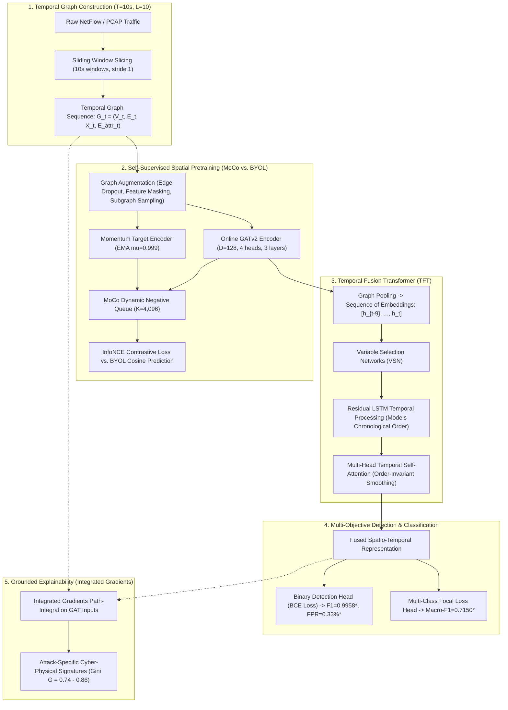

# MSc Thesis Guideline & Research Blueprint

## Project Identity & Working Title
* **Official Thesis Title:** *"Momentum-Contrastive Spatio-Temporal Graph Attention Networks for Explainable IoT Intrusion Detection"*
* **Working Framework Title:** **MC-STGAT-IDS**
* **Approved Shorter Variant:** *"A Hybrid Self-Supervised Graph Attention and Temporal Fusion Framework for IoT Network Intrusion Detection"*
* **Target Venues:** IEEE Transactions on Dependable and Secure Computing (TDSC), IEEE Transactions on Network and Service Management (TNSM), Computers & Security (Elsevier), Journal of Network and Computer Applications (JNCA).

---

## 1. Executive Summary & Research Motivation

Modern Network Intrusion Detection Systems (NIDS) operating in Internet of Things (IoT) and enterprise infrastructures confront three fundamental operational bottlenecks:
1. **Stealthy Precursor Blindness:** Multi-stage cyberattacks (e.g., slow reconnaissance scans preceding credential brute-forcing, lateral movement, and command-and-control beaconing) unfold chronologically across time. Classical machine learning (MLP) and static Graph Neural Networks (GCN, GAT, GraphSAGE) evaluate individual static snapshots, ignoring inter-window temporal dependencies.
2. **SOC Alert Fatigue:** Excessive False Positive Rates (FPR $\ge 15\text{--}30\%$) flood Security Operations Centers (SOC) with thousands of spurious alerts per hour, obscuring real security compromises.
3. **Severe Class Imbalance & Minority Attack Collapse:** Dominant high-volume traffic (DDoS floods, background benign traffic) suppresses minority zero-day threats (e.g., subtle C&C beacons, stealthy Telnet brute force), causing non-contrastive models to suffer representational collapse.

**MC-STGAT-IDS** unifies multi-hop spatial Graph Attention Networks (GATv2), contrastive Momentum Contrast (MoCo) pretraining, and a Temporal Fusion Transformer (TFT) with residual LSTM sequence modeling to resolve these three challenges simultaneously.

---

## 2. Research Gap & Core Scientific Contributions

Existing state-of-the-art graph-based NIDS exhibit specific architectural limitations:
* **Anomal-E (Caville et al., 2022):** Relies on isotropic E-GraphSAGE with Deep Graph Infomax (DGI) edge reconstruction and classical anomaly detectors (PCA/Isolation Forest), lacking multi-hop directional attention and temporal sequence tracking.
* **PPT-GNN (Van Langendonck et al., 2025):** Employs self-supervised link prediction over heterogeneous graphs; while effective for static topology, link prediction does not enforce hyperspherical feature separation for rare attack distributions.
* **GraphIDS (Guerra et al., NeurIPS 2025):** Combines E-GraphSAGE with a Transformer masked autoencoder (MAE) to reconstruct flow embeddings, detecting anomalies via high reconstruction error. However, reconstruction errors struggle on complex, multi-stage attack progressions.

### Novel Contributions of MC-STGAT-IDS:
1. **Momentum-Contrastive Graph Pretraining (MoCo vs. BYOL):** Porting contrastive momentum learning with a dynamic negative queue ($K = 4,096$) to network flow graphs. MoCo prevents representational collapse on minority attack vectors, outperforming non-contrastive BYOL by **+40.7% relative Macro-F1** on Gotham IoT and slashing false alarms by **66.3%**.
2. **Multi-Hop Directional Spatial GAT Backbone:** Multi-head GATv2 layers with continuous edge-attribute concatenation, enabling the network to learn which topological communication hops matter for distinguishing malicious lateral movement from legitimate multi-tier traffic.
3. **Temporal Sequence Modeling & The Sequence-Attention Discovery:** Combining Variable Selection Networks (VSN), multi-head attention, and a residual LSTM backbone across continuous observation windows ($L = 10$). Controlled permutation ablations prove that sequence order is essential (a **27.6 percentage point collapse** in Macro-F1 under sequence shuffling), while temporal attention entropy remains invariant ($\Delta\mathcal{H} = -0.0017$). This establishes that the **residual LSTM backbone models temporal sequence ordering**, while temporal self-attention functions as an order-invariant smoothing prior.
4. **Actionable Spatial Feature Explainability via Integrated Gradients:** Resolving the empirical boundary condition of diffuse temporal attention ($\mathcal{H} \approx 2.29\text{--}2.30$ nats) by formulating post-hoc path-integral attribution on spatial GAT inputs. Integrated Gradients isolates sharp cyber-physical feature drivers (Gini $G = 0.74\text{--}0.86$) per attack family (e.g., payload consistency for C&C beacons vs. zero-payload flag ratios for port scans).

---

## 3. Evaluated Benchmark Datasets

The framework is evaluated across three diverse, modern network traffic benchmarks under unified 10-second non-overlapping observation windows ($T_{\text{win}} = 10\text{s}$, sliding sequence history $L = 10$ steps, stride $S = 1$). All splits follow strict chronological partitioning to eliminate temporal lookahead leakage:

| Benchmark Dataset | Environment / Capture Domain | Total Sequences ($L=10$) | Train / Val / Test Sequences | Test Split Balance | Primary Evaluated Attack Classes | Graph Features |
| :--- | :--- | :---: | :---: | :---: | :--- | :---: |
| **Gotham IoT (2025)** | Cyber-Range Multi-Subnet IoT | 3,369 | 2,526 / 419 / 424 | 305 Benign / 119 Attack (28.1% attack) | Mirai Botnet, Merlin C&C, Telnet Brute, TCP Scan | 7 Node / 10 Edge |
| **NF-ToN-IoT-v3 (2023)** | Enterprise Server NetFlow v3 | 29,495 | 21,625 / 3,888 / 3,982 | 465 Benign / 3,517 Attack (88.3% attack) | DDoS, DoS, Backdoor, Injection, Ransomware, Password | 7 Node / 10 Edge |
| **NF-BoT-IoT-v3 (2023)** | Volumetric IoT NetFlow v3 | 6,232 | 4,625 / 800 / 807 | 247 Benign / 560 Attack (69.4% attack) | DoS, DDoS, Reconnaissance, Data Theft | 7 Node / 10 Edge |

### Dataset Profiles:
* **Gotham IoT (2025):** Multi-segment IoT cyber-range (Cardiff University & Toshiba) encompassing smart home, industrial sensors, wearables, and appliances communicating over MQTT, CoAP, and RTSP. Features authentic multi-stage attack campaigns with unseen zero-day evaluation.
* **NF-ToN-IoT-v3 (2023):** Standardized NetFlow v3 enterprise IoT capture (UNSW Canberra) spanning enterprise servers, web attacks, backdoors, injections, and ransomware.
* **NF-BoT-IoT-v3 (2023):** Standardized NetFlow v3 capture dominated by high-volume volumetric floods (DoS/DDoS) and reconnaissance probes.

---

## 4. Phased Execution Plan & Completed Milestones

| Phase | Milestone / Focus | Completed Technical Deliverables | Status |
| :---: | :--- | :--- | :---: |
| **Phase 0** | Literature Review & Formulation | Literature benchmark comparing Anomal-E, PPT-GNN, and GraphIDS; mathematical formulation of momentum graph SSL. | Complete |
| **Phase 1** | Graph Construction & Windowing | Temporal windowing ($T=10\text{s}$, $L=10$); node/edge feature extraction; strictly chronological train/val/test splits. | Complete |
| **Phase 2** | SSL Pretraining Benchmark | Contrastive MoCo ($K=4,096$) vs. Non-contrastive BYOL pretraining; t-SNE/UMAP manifolds; linear probe evaluations. | Complete |
| **Phase 3** | Temporal Fusion Transformer | TFT implementation with VSN, residual LSTM, multi-head attention; single and 3-seed ensemble frozen/fine-tuning. | Complete |
| **Phase 4** | Controlled Validation Suite | Snapshot baseline ablation; sequence order permutation ablation ($\pi(t)$); $3 \times 3$ cross-dataset zero-shot transfer matrix. | Complete |
| **Phase 5** | Grounded Explainability (XAI) | Integrated Gradients on spatial GAT inputs; Gini attribution sparsity analysis; attention entropy diagnostic ($\Delta\mathcal{H}$). | Complete |
| **Phase 6** | Publication Reports & Code Release | 6-page Main Report PDF (`report.pdf`), 5-page Transposed Report PDF (`report_transposed.pdf`), LaTeX source, GitHub repo. | Complete |

---

## 5. Detailed Technical Architecture & Pipeline Specification



### 5a. Spatial Graph Backbone
* **Nodes ($V_t$):** IP hosts / IoT devices. Node attributes ($X_t \in \mathbb{R}^{|V_t| \times 7}$) encode topological degree centrality and bidirectional flow volume statistics.
* **Edges ($E_t$):** Directed network communications between hosts. Edge attributes ($E_{\text{attr}} \in \mathbb{R}^{|E_t| \times 10}$) encode continuous flow features (packet counts, byte volumes, duration, protocol flags, interarrival times).
* **Backbone Architecture:** 3-layer GATv2 with 4 attention heads and latent dimension $D = 128$.

### 5b. Self-Supervised Pretraining: Contrastive MoCo vs. BYOL
* **MoCo Architecture:** Online GATv2 network paired with a momentum-updated target GATv2 network ($\mu = 0.999$) and a dynamic negative queue of $K = 4,096$ historical representations. Pretrained using InfoNCE loss with temperature $\tau = 0.07$.
* **BYOL Architecture:** Online network with prediction MLP head aligned to momentum target network via mean squared cosine error, operating without negative samples.
* **Empirical Winner:** MoCo consistently outperforms BYOL in multi-class attack discrimination (+20.67% absolute Macro-F1 on Gotham) and suppresses false alarm rates (0.33% vs. 0.98%).

### 5c. Temporal Sequence Fusion (TFT)
* **Input:** Sequence of $L = 10$ graph embeddings ($h_{t-9}, \dots, h_t$).
* **Components:** Variable Selection Networks (VSN), gated residual connections, residual LSTM backbone, and multi-head temporal self-attention ($D_{\text{model}} = 384$, 2 heads).
* **Supervised Training:** Joint Binary Cross-Entropy and Multi-Class Focal Loss ($\gamma = 2.0$, $\alpha = 0.25$) to prevent loss starvation on minority attack families.

### 5d. Grounded Feature Attribution (Integrated Gradients)
* Path-integral attribution computed directly on GAT input node and edge attributes:
  $$\text{Attr}_i(x) = (x_i - x'_i) \times \int_{0}^{1} \frac{\partial F(x' + \alpha(x - x'))}{\partial x_i} \, d\alpha$$
* Resolves diffuse temporal attention by identifying sharp, cyber-physically interpretable feature attributions per attack vector (Gini sparsity $G = 0.74\text{--}0.86$).

---

## 6. Controlled Empirical Validation Suite

The thesis incorporates three controlled validation experiments to rigorously substantiate all theoretical claims:

### Experiment 1: Snapshot-Only Baseline vs. Full-Sequence TFT
* **Hypothesis:** Does multi-window temporal processing provide measurable lift over evaluating only the final observation window?
* **Finding:** On multi-stage cyber-range traffic (Gotham IoT), full sequence modeling provides a **+10.22% absolute Macro-F1 lift** ($0.7150$ vs. $0.6128$) and **+2.53% Binary F1 lift** ($0.9958$ vs. $0.9705$). On steady-state enterprise traffic (NF-ToN-IoT-v3), snapshot representations are already highly separable ($\Delta\text{ROC} = +0.0005$). On instantaneous volumetric floods (NF-BoT-IoT-v3), temporal smoothing introduces overhead, where static models perform effectively.

### Experiment 2: Sequence Order Permutation Ablation ($\pi(t)$)
* **Hypothesis:** Does the model strictly depend on chronological sequence ordering, and is this dependency captured by temporal attention?
* **Finding:** Randomly permuting sequence order during evaluation collapses Gotham Macro-F1 by **27.6 percentage points** ($0.7150 \to 0.4393$, a **38.6% relative collapse**), proving chronological sequence is vital. Yet temporal attention entropy is invariant ($\Delta\mathcal{H} = -0.0017$). This demonstrates that the **residual LSTM backbone models temporal sequence ordering**, while temporal self-attention acts as an order-invariant smoothing prior.

### Experiment 3: 3x3 Cross-Dataset Zero-Shot Transfer Matrix
* **Hypothesis:** How well do representations learned on one network capture transfer to unseen network environments without retraining?
* **Finding:** Models pretrained on NF-BoT-IoT-v3 achieve strong zero-shot transfer to NF-ToN-IoT-v3 ($\text{ROC} = 0.9117$, $\text{F1} = 0.9415$) due to shared NetFlow v3 schema and volumetric attack primitives. Cross-domain transfer between synthetic cyber-ranges (Gotham) and NetFlow captures exhibits domain shifts, highlighting the necessity of in-domain structural pretraining.

---

## 7. Comparative Baselines & Evaluation Metrics Suite

### Evaluated Model Suite:
1. **Classical Machine Learning:** Multi-Layer Perceptron (MLP) on aggregated tabular flow features.
2. **Static Spatial GNNs:** Graph Convolutional Network (GCN), Graph Attention Network (GATv2), and Inductive GraphSAGE.
3. **Self-Supervised Graph Baselines:** Anomal-E (E-GraphSAGE + DGI edge reconstruction).
4. **Proposed Spatio-Temporal Models:** MC-STGAT (BYOL-Frozen, BYOL-FineTuned, MoCo-Frozen Single, MoCo-Frozen Ensemble, MoCo-FineTuned).

### Metric Definitions:
* **Binary Detection:** Binary F1 Score, ROC-AUC, PR-AUC, False Positive Rate (FPR %), False Negative Rate (FNR %).
* **Multi-Class Attribution:** Macro-F1, Weighted F1, Per-Class ROC-AUC vs. Benign.
* **Explainability Diagnostics:** Shannon Attention Entropy ($\mathcal{H} = -\sum \alpha_i \ln \alpha_i$), Gini Sparsity Coefficient ($G \in [0, 1]$).

---

## 8. Software Environment, Compute Specifications & Codebase Layout

* **Frameworks:** Python 3.9+, PyTorch 2.x, PyTorch Geometric (PyG), ReportLab, Matplotlib, Seaborn, Scikit-Learn.
* **Compute Footprint:** Single GPU (NVIDIA RTX / T4 / P100 with $\ge 8$ GB VRAM) is sufficient for all pretraining and evaluation phases.
* **Repository Architecture:**
  ```text
  MC-STGAT-IDS/
  ├── 0_2_phase_Dataset_Explore.ipynb       # Phase 0: Exploratory data analysis & graph topology
  ├── 1_1_phase_multi_window_graph.ipynb    # Phase 1.1: Multi-window graph slicing (T=10s, L=10)
  ├── 1_2_phase_graph_build.ipynb           # Phase 1.2: PyG dataset construction & normalization
  ├── 1_3_phase_Baseline.ipynb              # Phase 1.3: Classical & GNN baselines (MLP, GCN, GAT, GraphSAGE, Anomal-E)
  ├── 2_1_phase_SSL_BYOL.ipynb              # Phase 2.1: Non-contrastive BYOL graph pretraining
  ├── 2_2_phase_SSL_MOCO.ipynb              # Phase 2.2: Contrastive MoCo graph pretraining (K=4,096 queue)
  ├── 3_1_phase_TFT_BYOL.ipynb              # Phase 3.1: TFT sequence modeling with BYOL encoder
  ├── 3_1_phase_TFT_MOCO.ipynb              # Phase 3.1: TFT sequence modeling with MoCo encoder
  ├── 3_2_phase_Visualization.ipynb         # Phase 3.2: Empirical showdown plots & performance radar
  ├── 3_3_phase_XAI.ipynb                   # Phase 3.3: Multi-tier XAI suite & Integrated Gradients
  ├── 4_1_phase_Controlled_Validation.ipynb # Phase 4.1: Controlled validation (Snapshot, Shuffle, Transfer Matrix)
  ├── dataset_diagnostic.ipynb              # Diagnostic: Sequence vs. snapshot linear separability
  ├── per_family_probe_Byol.ipynb           # Diagnostic: BYOL attack-family linear probe discrimination
  ├── per_family_probe_MoCo.ipynb           # Diagnostic: MoCo attack-family linear probe discrimination
  ├── report.md / report.pdf / report.tex   # Master 6-page publication research report & LaTeX manuscript
  ├── report_transposed.md / report_transposed.pdf / report_transposed.tex # Transposed 5-page report
  ├── figures/                              # High-resolution publication showdown figures
  ├── final_plot/                           # Complete empirical plot suite generated by 3_2_phase_Visualization
  └── baseline_checkpoints_tftparity/       # Checkpoint weights for baseline models
  ```

---

## 9. Thesis Chapter Mapping

* **Chapter 1: Introduction** — IoT operational challenges, stealthy precursor blindness, alert fatigue, research questions.
* **Chapter 2: Related Work & Background** — Graph-based NIDS, self-supervised learning on graphs, temporal sequence transformers, positioning against Anomal-E, PPT-GNN, and GraphIDS.
* **Chapter 3: Methodology (MC-STGAT-IDS)** — Mathematical formulation of GATv2 backbone, contrastive MoCo pretraining, Temporal Fusion Transformer with residual LSTM, and Integrated Gradients.
* **Chapter 4: Experimental Setup & Benchmarks** — Gotham IoT (2025), NF-ToN-IoT-v3, NF-BoT-IoT-v3, chronological splitting protocols, evaluation metrics.
* **Chapter 5: Empirical Benchmark & Downstream Results** — MoCo vs. BYOL showdown, baseline comparisons, false alarm suppression, minority attack attribution.
* **Chapter 6: Controlled Validation & Interpretability Analysis** — Snapshot baseline ablation, sequence order permutation discovery, $3 \times 3$ transfer matrix, Integrated Gradients cyber-physical feature signatures.
* **Chapter 7: Discussion, Limitations & Future Work** — Operational deployment boundaries, inference latency profiles, conclusions.
