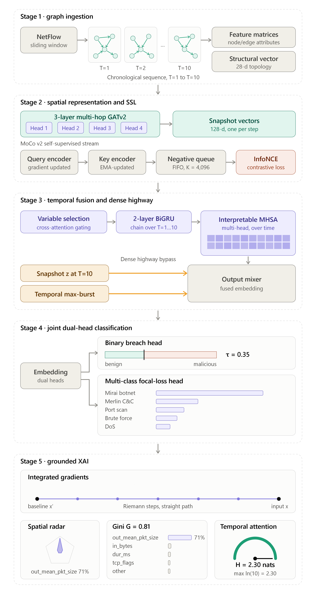

# MC-STGAT-IDS: Momentum-Contrastive Spatio-Temporal Graph Attention Networks for IoT Intrusion Detection

[](https://www.python.org/)
[](https://pytorch-geometric.readthedocs.io/)
[](thesis.pdf)
[](publication_report/report.pdf)
[](#architecture-overview)

This repository contains the complete experimental suite, executed Jupyter notebooks, baseline checkpoints, LaTeX thesis sources, and publication materials for **MC-STGAT-IDS** (*Momentum-Contrastive Spatio-Temporal Graph Attention Network for Intrusion Detection*).

---

## Master's Thesis & Research Report

- **[thesis.pdf](thesis.pdf)**: Complete, defended 91-page Master's Thesis dissertation (University LaTeX sources located in [`thesis/`](thesis/)).
- **[publication_report/report.pdf](publication_report/report.pdf)**: 11-page condensed research summary article formatted for journal/conference submission.
- **[master_result.json](master_result.json)**: Authoritative, audited experimental database containing all 813 verified empirical metrics across all 3 datasets, 6 baselines, and model variants.

---

## Architecture Overview

MC-STGAT-IDS unifies spatial graph neural networks, self-supervised contrastive learning, and multi-scale temporal highway fusion to protect modern IoT and enterprise networks across distinct traffic regimes:



### The 5 Operational Stages:
1. **Dynamic Graph Ingestion:** Continuous sliding-window graph formation ($W_t = 10\text{ s}$, stride $S = 1\text{ s}$, window length $L = 10$) mapping NetFlow/IP telemetry into dynamic graphs with 7 node features, 10 edge features, and 28-d structural graph metrics.
2. **Self-Supervised Spatial Graph Pretraining:** 3-layer Multi-Hop GATv2 backbone with edge feature concatenation, pretrained using Momentum Contrast (MoCo v2 with dynamic negative queue $K = 4,096$, $\tau = 0.07$, EMA momentum $\mu = 0.999$) to prevent minority attack collapse.
3. **Dense Spatio-Temporal Highway Sequence Modeling:** Temporal sequence processing driven by a **2-layer BiGRU backbone** and Multi-Head Temporal Self-Attention, augmented with **Dense Spatio-Temporal Highways** (raw snapshot bypass, max-pooling bursts, velocity vectors, and GRN gating) that completely bypass temporal low-pass dilution during high-rate volumetric floods.
4. **Joint Multi-Task Classification Heads:** Bifurcated prediction heads for line-rate Binary Breach Detection ($\mathcal{L}_{\text{BCE}}$, asymmetric binary focal loss with $\text{pos\_weight} = 1.5$ and nominal $\tau = 0.35$) and Multi-Class Attack Attribution ($\mathcal{L}_{\text{FL}}$ with balanced softmax logit margins).
5. **Grounded Explainability via Integrated Gradients:** Axiomatic path-integral feature attribution on spatial GAT inputs across 50 Riemann steps, discovering sharp, class-specific cyber-physical drivers ($G = 0.74\text{--}0.86$) that resolve the explainability boundary left by diffuse temporal attention ($\mathcal{H} \approx 2.30\text{ nats}$).

---

## Key Experimental Findings

1. **Multi-Stage Kill Chain Resolution (Gotham IoT):**
   - MC-STGAT (frozen single-seed) achieves **$0.7150^*$ Multi-Class Macro-F1** (+40.7% relative to BYOL $0.5081$, and +40.2% over GraphSAGE $0.5101$).
   - Achieves **$0.0000^*$ False Negative Rate** ($0$ missed attacks out of $n=119$; rule-of-three 95% CI: $[0, 2.5\%]$), whereas static GCN misses $66.84\%$ of attacks and MLP misses $16.04\%$.
2. **Enterprise False Positive Suppression (NF-ToN-IoT-v3):**
   - Single-seed MC-STGAT suppresses SOC false alarms down to **$9.25\%^*$ FPR**, outperforming Supervised GAT ($17.99\%$) and Anomal-E ($29.66\%$).
3. **Volumetric Flood Highway Breakthrough (NF-BoT-IoT-v3):**
   - Baseline TFT suffered from temporal attention low-pass dilution ($\text{FNR} = 30.54\%$).
   - The upgraded Dense Highway surges single-seed Binary F1 to **$0.9265$** ($\text{FNR} = 0.89\%$), and the 3-seed ensemble achieves **$0.7501$ Macro-F1** with **$0.0000^*$ FNR** ($0$ missed attacks out of $n=560$; rule-of-three 95% CI: $[0, 0.53\%]$), beating static GraphSAGE ($0.6824$), GCN ($0.6928$), Supervised GAT ($0.7346$), and E-GraphSAGE ($0.7329$).
4. **Indispensability of Temporal Ordering:**
   - Shuffling sequence order ($\pi(t)$) causes Gotham Macro-F1 to collapse by **27.6 percentage points** (from $0.7150$ to $0.4393$, a $38.6\%$ relative collapse), proving that sequence order is modeled by the recurrent BiGRU backbone, while self-attention serves as an order-invariant context-smoothing prior.

---

## Repository Structure

```text
├── thesis.pdf                             # Complete defended 91-page Master's Thesis
├── master_result.json                     # Complete verified experimental database (813 metrics)
│
├── 0_2_phase_Dataset_Explore.ipynb        # Phase 0: Telemetry exploration and schema audit
├── 1_1_phase_multi_window_graph.ipynb     # Phase 1: Sliding temporal graph sequence windowing
├── 1_2_phase_graph_build.ipynb            # Phase 1: Feature construction and structural graph metrics
├── 1_3_phase_Baseline.ipynb               # Benchmark: Evaluates 6 classical and inductive baselines
├── 2_1_phase_SSL_BYOL.ipynb               # Phase 2: Non-contrastive BYOL self-supervised pretraining
├── 2_2_phase_SSL_MOCO.ipynb               # Phase 2: Momentum Contrast (MoCo v2) pretraining
├── 3_1_phase_TFT_BYOL.ipynb               # Phase 3: Downstream TFT evaluation with BYOL encoder
├── 3_1_phase_TFT_MOCO.ipynb               # Phase 3: Downstream TFT evaluation with MoCo encoder
├── 3_2_phase_Visualization.ipynb          # Phase 3: t-SNE, UMAP, ROC/PR curves, confusion matrices
├── 3_3_phase_XAI.ipynb                    # Phase 5: Integrated Gradients feature reliance analysis
├── 4_1_phase_Controlled_Validation.ipynb  # Ablations: Permutation ablation, snapshot vs. sequence
├── dataset_diagnostic.ipynb               # Dataset validation and integrity diagnostics
├── per_family_probe_Byol.ipynb            # Fine-grained attack family probing for BYOL
├── per_family_probe_MoCo.ipynb            # Fine-grained attack family probing for MoCo
│
├── thesis/                                # Full LaTeX source tree for Master's Thesis
│   ├── chapters/                          # Chapters 1 through 7 (Intro to Conclusion)
│   ├── figures/                           # High-res vector and raster figures for thesis
│   ├── references.bib                     # Complete BibTeX bibliography
│   └── thesis.tex                         # Master LaTeX document
│
├── publication_report/                    # Condensed 11-page publication paper
│   ├── report.pdf                         # 11-page publication-ready PDF
│   ├── report.tex                         # LaTeX source
│   └── report.md                          # Markdown source
│
├── scripts/                               # Production runners and evaluation scripts
│   ├── 3_1_phase_TFT_BYOL.py              # CLI runner for BYOL fine-tuning
│   ├── 3_1_phase_TFT_MOCO.py              # CLI runner for MoCo fine-tuning
│   ├── generate_master_result.py          # Master results JSON aggregation engine
│   └── run_production_pipeline.py         # End-to-end multi-seed pipeline runner
│
├── docs/                                  # Research documentation and literature reviews
│   └── literature_review.md               # Encoder & pretext task benchmark review
│
├── figures/                               # Publication and benchmark figures
├── comparison_plots/                      # Cross-model comparative charts
├── split_plots/                           # Temporal split and distribution plots
├── per_family_plots/                      # Attack family breakdown charts
├── xai_plots/                             # Integrated Gradients feature attribution heatmaps
├── tables/                                # Raw CSV metrics and window summaries
└── baseline_checkpoints_tftparity/        # Pretrained baseline model weights (.pt)
```

---

## Environment Setup & Reproduction

### Prerequisites
- Python 3.10+
- PyTorch 2.1+ with CUDA support
- PyTorch Geometric (PyG) 2.4+
- `pip install -r requirements.txt`

### Inspecting Results
All 14 Jupyter notebooks (`*.ipynb`) in this repository contain fully executed outputs, loss curves, confusion matrices, and metrics. You can open and review them immediately in JupyterLab or VS Code without needing to re-run expensive training cycles.

To inspect the master results programmatically:
```python
import json

with open("master_result.json", "r", encoding="utf-8") as f:
    results = json.load(f)

# Inspect verified Gotham IoT results
print("Gotham MoCo Frozen Macro-F1:", results["tft_evaluation"]["gotham"]["moco"]["frozen"]["single"]["test_macro_f1"])
```

### Building the Thesis LaTeX
To compile the full Master's Thesis from source:
```bash
cd thesis
pdflatex thesis.tex
bibtex thesis
pdflatex thesis.tex
pdflatex thesis.tex
```

---

## Documentation Links

- **[ARCHITECTURE_AND_PIPELINE.md](ARCHITECTURE_AND_PIPELINE.md)**: Deep technical specification of tensor shapes, layer formulas, and Dense Highway connections.
- **[BENCHMARK_AND_RESULTS_REFERENCE.md](BENCHMARK_AND_RESULTS_REFERENCE.md)**: Verified benchmark tables and authoritative numerical figures.
- **[DATASETS.md](DATASETS.md)**: Network telemetry datasets (Gotham IoT, NF-ToN-IoT-v3, NF-BoT-IoT-v3).
- **[ENVIRONMENT.md](ENVIRONMENT.md)**: Hardware specifications and Python package versions.
- **[docs/literature_review.md](docs/literature_review.md)**: Comparative analysis of GNN-NIDS encoders and self-supervised pretext tasks.
